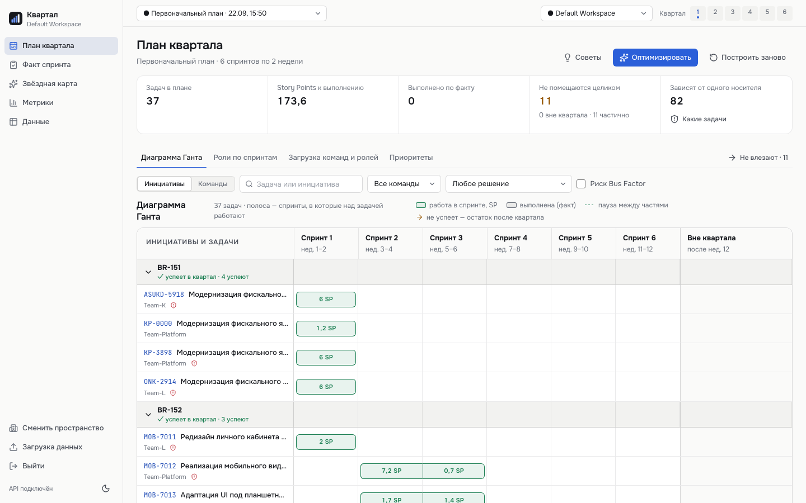
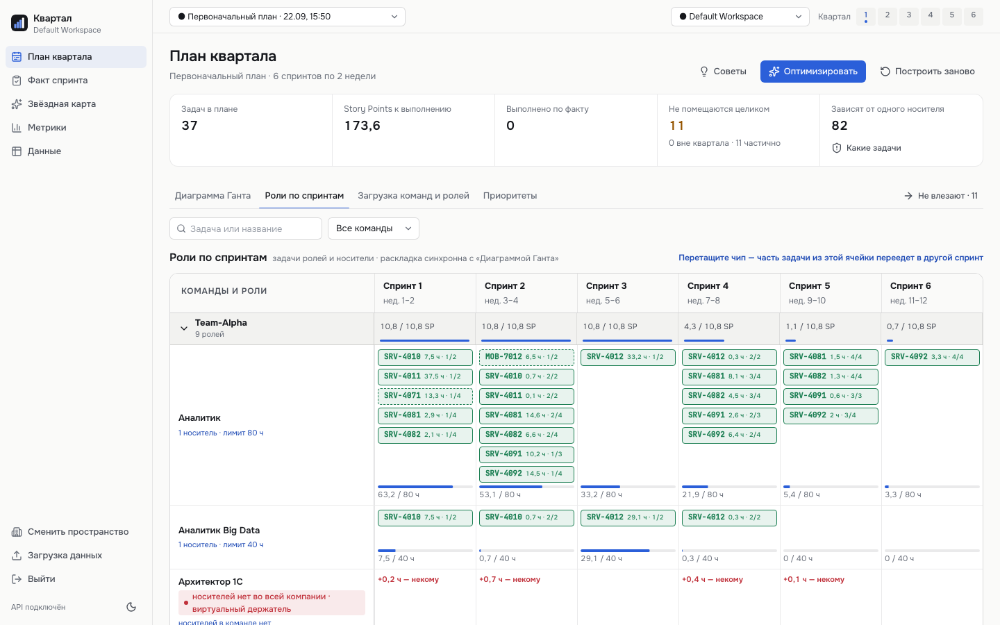
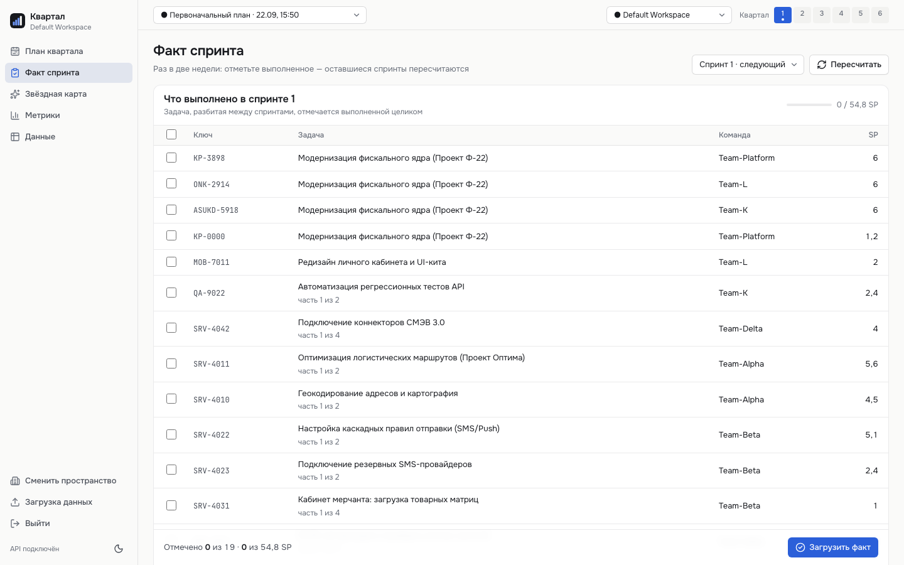
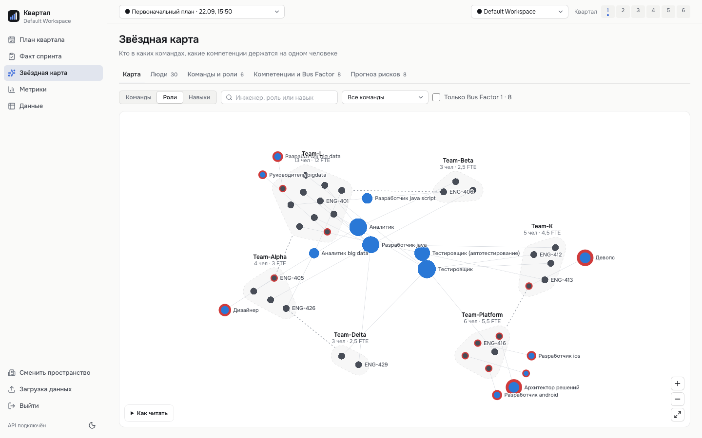
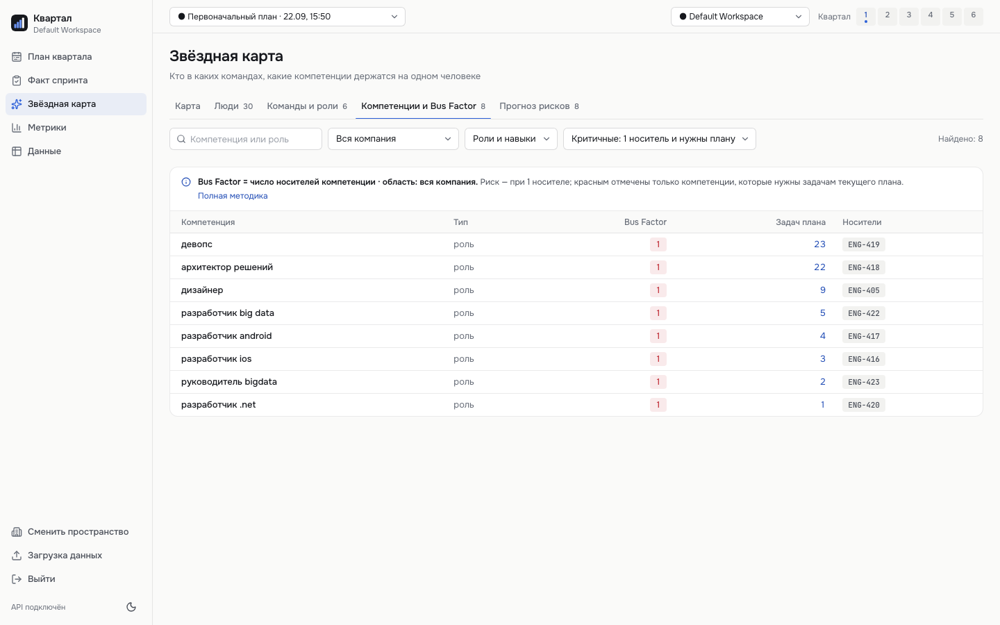
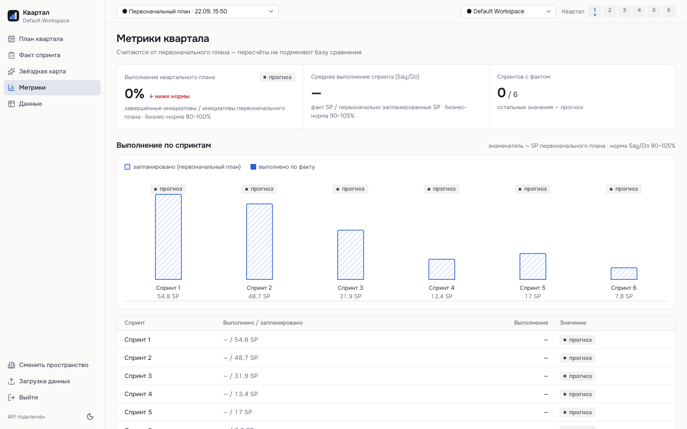

# PostCode Challenge: квартальное планирование команд и звёздная карта

Решение [задания](задание%20PostCode.md). Сервис составляет **выполнимый квартальный план** (6 спринтов × 2 недели = 12 недель), пересчитывает его по фактическим результатам спринтов и показывает **риски загрузки и компетенций** команд (звёздная карта + Bus Factor).

Кому нужно: тимлидам, ресурсным менеджерам, ИТ-директору. Суммарной оценки задач недостаточно — выполнимость зависит от velocity команды, рабочего времени специалистов, потребности в ролях и зависимостей между задачами.

## Быстрый старт

Требования: **docker** (связка одной командой) или [uv](https://docs.astral.sh/uv/) + Node.js 22.

```bash
docker compose up -d --build
# http://localhost:5173 → «Войти как администратор» · Swagger: http://localhost:8000/docs
```

Поднимаются `db` (PostgreSQL 16) + `api` (uvicorn :8000, демо-датасет импортируется сразу) + `frontend` (nginx :5173, проксирует `/api` `/auth` `/workspaces` `/permissions`).

Профили compose: `jobs` — Redis + arq-воркер (фоновые джобы), `optimizer` — Timefold-solver (Java 21). Без них оптимизация отрабатывает жадной эвристикой.

```bash
docker compose --profile jobs --profile optimizer up -d --build

# залить демо-датасет (нужна демо-сессия editor/admin)
TOKEN=$(curl -s -X POST localhost:8000/auth/demo-login -H 'content-type: application/json' \
  -d '{"role":"admin"}' | python3 -c 'import json,sys; print(json.load(sys.stdin)["access_token"])')
curl -X POST localhost:8000/api/v1/data/import -H "Authorization: Bearer $TOKEN"
```

Сценарий: `/plan` → «Построить план» → «Оптимизировать» (при живом optimizer — режим solver). Остановка: `docker compose --profile jobs --profile optimizer down`; `down -v` — пересоздать БД (обязательно после смены схемы, alembic-миграций нет).

Конфиг — `.env` (шаблон `example.env`): `POSTCODE_DATABASE_URL`, `POSTCODE_LLM_PROVIDER` (`gigachat` | `ollama` | `none`), ключи `GIGACHAT_*`, `POSTCODE_OLLAMA_*`, `POSTCODE_OPTIMIZER_BASE_URL`.

Локально: `uv sync`, `uv run scripts/split_dataset.py`, `docker compose up -d db`, `uv run uvicorn src.main:app --reload`. Тесты: `uv run pytest tests/ -q` (SQLite, без docker). NixOS: `./scripts/fix-venv-nix.sh`.

## Запуск с нуля в Docker (подробно)

Полный путь от пустой машины до работающего демо-сценария.

### 1. Требования

- **Docker 24+** с compose-плагином (`docker compose version`), ~4 ГБ свободной RAM.
- Порты **5173, 8000, 8001, 5432, 6379** свободны.
- Опционально: ключи GigaChat для AI-советника (без них советник работает в детерминированном fallback-режиме — демо-сценарию не мешает).

### 2. Конфигурация

```bash
cp example.env .env
# при наличии ключа GigaChat (физлицо, scope GIGACHAT_API_PERS) — вписать в .env:
#   GIGACHAT_CLIENT_SECRET=...  GIGACHAT_SCOPE=GIGACHAT_API_PERS
```

### 3. Сборка и запуск

```bash
docker compose --profile jobs --profile optimizer up -d --build
```

| Сервис | Назначение | Порт / проверка |
|---|---|---|
| `db` | PostgreSQL 16 | 5432 · healthcheck в `docker compose ps` |
| `api` | FastAPI (uvicorn) | 8000 · `curl -sf localhost:8000/healthz` |
| `frontend` | nginx + SPA | 5173 · `curl -sf localhost:5173` |
| `redis` | очередь фоновых джобов | 6379 |
| `worker` | arq-воркер (импорт, optimize-jobs) | логи: `docker compose logs -f worker` |
| `optimizer` | Timefold-solver (Java 21) | 8001 · `curl -sf localhost:8001/health` |

Дождаться `healthy` у `db` и `optimizer` в `docker compose ps` (первая сборка optimizer идёт несколько минут — Maven Central; повторные из кэша).

> **VPN-окружение.** Скачивание пакетов при сборке (Maven/npm/uv) идёт через **host-сеть** (`network: host` в секциях `build` compose-файла): bridge-сеть контейнеров не проходит через VPN-туннель. На обычной сети это безвредно.

### 4. Загрузка демо-датасета

```bash
TOKEN=$(curl -s -X POST localhost:8000/auth/demo-login -H 'content-type: application/json' \
  -d '{"role":"admin"}' | python3 -c 'import json,sys; print(json.load(sys.stdin)["access_token"])')
curl -X POST localhost:8000/api/v1/data/import -H "Authorization: Bearer $TOKEN"
# {"status":"imported","counts":{"tasks":45,"engineers":34,...}}
```

Или из UI: «Данные» → загрузка `Датасет_с_правками_основной.xlsx` → подтвердить.

### 5. Демо-сценарий (основной пользовательский путь)

1. `http://localhost:5173` → **«Войти как администратор»** (демо-сессия, без пароля).
2. **План** → «Построить план» — распределение по 6 спринтам с причиной каждого решения.
3. «**Оптимизировать**» — вуаль «Solver перестраивает расстановку…» (работает и после ухода со страницы); новая версия плана в режиме solver (без optimizer — жадная эвристика).
4. Вкладки **Гант / Роли по спринтам / По командам** — займы, дефициты, перенос задач drag-and-drop (pin с проверками ёмкости и зависимостей).
5. **Факт спринта** → загрузить результаты спринта 1 → план пересчитан со 2-го, риски (выход за квартал, сдвиг цепочки, дефицит роли, изменение состава).
6. **Звёздная карта** → команды/роли/грейды, единственные носители; **Bus Factor** с методикой рядом.
7. **Метрики** → % квартала по инициативам и спринтам, факт/прогноз; **AI-советник** — вопрос в комментарии (например «кого нанять до 1 спринта?»).

### 6. Управление и сброс

```bash
docker compose logs -f api                                    # логи API
docker compose --profile jobs --profile optimizer down        # остановить (данные сохраняются)
docker compose down -v                                        # + удалить БД (обязательно после смены схемы — миграций нет)
docker compose --profile jobs --profile optimizer down -v --rmi local   # полный сброс: контейнеры, БД, образы
docker compose --profile jobs --profile optimizer build --no-cache      # пересборка с нуля
```

### 7. Траблшутинг

| Симптом | Решение |
|---|---|
| `port is already allocated` | освободить порт или поменять маппинг в `docker-compose.yml` |
| Таймауты скачивания пакетов при сборке | VPN блокирует bridge-сеть — host-сеть уже настроена; при прокси пробросить `HTTP(S)_PROXY` в build args |
| `optimizer` не healthy | смотреть `docker compose logs optimizer`; без него оптимизация работает эвристикой — сценарий не блокируется |
| Советник «режим: fallback» | нет ключа/сети до GigaChat — штатная деградация, советы детерминированные |
| Пустой план / 400 «нет данных» | сначала шаг 4 (импорт датасета) |

## Возможности

- **Квартальный план** — распределение задач по 6 спринтам, **причина каждого решения** (включена / перенесена / отменена), приоритеты, двухшаговая отмена.
- **Пересчёт по факту** — факт спринта → новая версия плана + 4 типа рисков: выход за квартал, сдвиг цепочки, дефицит роли, изменение состава.
- **Звёздная карта** — команды, роли, грейды, компетенции, распределение между командами, **Bus Factor** и единственные носители.
- **Метрики** — % выполнения квартала (по инициативам) и спринтов (по SP) от первоначальной базы, факт/прогноз.
- Дополнительно: AI-советник, оптимизация solver'ом, фоновые задачи (Redis), рабочие пространства, роли reader/editor/admin, редактор данных.

## Структура репозитория

```
src/                  FastAPI-бэкенд (Python 3.13)
  api/                REST-эндпоинты: routes (план/факты/метрики/советник), crud (редактор данных), auth
  services/           доменные сервисы: planner (жадный планировщик), optimize_plan (оркестрация
                      solver/эвристики), optimizer_client (снапшот/pre-split), metrics, bus_factor,
                      capacity, dependencies
  domain/             pydantic-модели (Task, Engineer, Plan, константы 80 ч/6 спринтов)
  db/                 ORM-модели, импортёр CSV, staging загрузок, сессии
  ai/                 LLM-клиенты (GigaChat, Ollama), пайплайны (advisor, normalization), jobs-воркер (arq)
optimizer/            Timefold-сайдкар (Java 21): домен, констрейнты, REST /solve
frontend/             React 19 + TypeScript (Vite), nginx-образ с прокси на api
dataset/              сгенерированные CSV (НЕ редактировать — см. scripts/split_dataset.py)
scripts/              split_dataset.py (xlsx → dataset/), утилиты окружения
openspec/             спеки capabilities (specs/) + архив changes (changes/archive/)
tests/                pytest: 150+ тестов на SQLite, без docker
docs/                 продуктовые документы, скриншоты для README
Датасет_с_правками_основной.xlsx   исходные данные хакатона
задание PostCode.md, Демо_онбординг.pdf   условие и онбординг
docker-compose.yml, Dockerfile, example.env, AGENTS.md, .githooks/
```

## Методологии расчёта

### Базовые ограничения (из условия и онбординга)

- **Ресурс команды** на спринт = средняя velocity из `team_history` × **0.8** (SP, Focus Factor). Нет истории → capacity 0, задачи не планируются.
- **Лимит специалиста** = **80 ч/спринт** (полная ставка) / **40 ч** (0.5); суммируется по всем командам инженера (parttime — 40+40, обе записи видны в профиле).
- **SP ≠ часы**: две независимые шкалы — SP-гейт (против velocity×0.8) и часовой гейт (против лимитов ролей). Прямой конверсии нет и не делается (см. «Допущения»); в датасете `estimated_hh/SP` ≈ 7.5–40.5 (медиана 25).
- **Статусы/объём**: `Done` — вне плана; `InProgress` — остаток `estimated_hh − spent_time` (SP — та же доля); `ToDo` — полный объём.
- **Зависимости**: блокируемая задача стартует **строго позже** последнего спринта блокера (зазор ≥ 1 спринт по онбордингу, п. Г); ссылки на отсутствующие задачи игнорируются; циклы — вне плана с причиной.
- **Разбиение**: задача на несколько спринтов (SP/часы пропорционально доле части); зависимые — после последней части блокера.

### Распределение часов ролей (жадный планировщик)

- **Приоритеты**: меньше — раньше; seed при импорте: `planned_in_sprint='Да'` → 10, остальные → 100 + порядок. Стратегии построения: `priority` (по приоритету) и `metrics` (скоринг по вкладу в инициативы).
- **Закрытие часов роли**: сначала **своя команда задачи** (по свободным часам); заём — только при нехватке своих в спринте, из **одной донорской команды** с максимальным суммарным свободным лимитом роли; если её не хватает — одна запасная; дальше часы **откладываются** в следующий спринт, а не собираются россыпью по 3+ командам.
- **Виртуальный держатель** (80 ч) для ролей без носителей в компании — часы закрываются, но метятся как дефицит («некому»).
- **Команда-исполнитель vs владелец**: у части задачи исполнитель может отличаться от владельца; в API `team_id` = исполнитель, `owner_team_id` = владелец; загрузка команд считается по исполнителям.
- **Минимальная часть роли — 2 ч**: роль с долей мельче не дробится, уходит целиком в последнюю часть (читабельность без осколков по 0.3 ч).
- **Причины**: каждая задача имеет решение (`planned`/`postponed`/`cancelled`/`done_actual`) с текстом причины; отмена двухшаговая (запрос → подтверждение).

### Оптимизация (solver + эвристика)

- **Pre-split**: задача режется на `k = min(6, ⌈часы÷80⌉)` частей (расширяется, если SP части выше ёмкости команды); части раскладываются независимо.
- **Solver (Timefold, Java 21)**: hard — SP-гейт команды, часы ролей (вся компания), зависимости, запрет переноса единственного носителя; soft — завершение инициатив (вес 100 000), приоритеты, утилизация команд (50), штраф staffing-переносов. Seed 42 (детерминизм), бюджет 180 с.
- **Ступень 2 (Python)**: часы частей закрепляются за конкретными инженерами тем же жадным распределителем; не влезшее сдвигается вперёд; сдвиги, нарушившие зависимости, чинятся каскадным repair (за спринт 6 — «выполнится частично»).
- **Отказоустойчивость**: solver недоступен/не feasible за бюджет/черновик невалиден — **не ошибка**, а деградация в жадную эвристику с честной причиной в отчёте. Оптимизация отрабатывает всегда.
- **Горизонт после фактов**: планирование со спринта `max(recomputed_after_sprint, последний факт) + 1`; закрытые спринты не перепланируются, выполненные задачи (`done_actual`) сохраняются в каждой новой версии.

### Закрепление (pin) и переносы

- Drag-and-drop на «Ролях по спринтам» → pin: перемещение **немедленное** (пересборки нет), можно двигать одну часть (`from_sprint_no`); строки задачи в целевом спринте сливаются по исполнителю.
- Проверки до записи: границы квартала, спринт не закрыт фактом, **зависимости по фактическим позициям плана** (блокер < цели < зависимая), ёмкость конкретного инженера. UI запрещает drag в нарушающие зависимости спринты с причиной.

### Метрики, Bus Factor, AI-советник

- **Bus Factor** = число носителей компетенции/роли (по `engineers_profiles`) в области `company` (workspace) или `team`; 0.5-ставочник — носитель в обеих командах; грейд не влияет; риск при факторе **≤ 1**. Методика и область показываются рядом с показателем; `GET /plans/{id}/bus-risk` — задачи под угрозой, `GET /plans/{id}/bus-forecast` — прогноз уровня риска.
- **Метрики**: % квартала = завершённые инициативы / инициативы с ≥1 задачей в первоначальном плане × 100 % (инициатива завершена, когда все её плановые задачи `done_actual`); % спринта = факт SP / план SP × 100 %. Знаменатель — от первоначального плана (пересчёты не подменяют базу); прогноз помечается. Нормы: PI Predictability 80–100 %, Sprint Say/Do 90–105 %.
- **AI-советник** (GigaChat/Ollama/fallback): сводка состояния плана (KPI, риски, отчёт оптимизации, кадровые предложения, **дефицит ролей по спринтам** = требуемые часы − лимиты носителей → ставки к найму) → советы `task_move | staffing_shift | initiative_rescue | sprint_priority | hiring`; вопрос пользователя в комментарии (≤ 500 симв.) — первый совет отвечает на него; до 3 попыток с backoff при сбоях API.

## Датасет

`Датасет_с_правками_основной.xlsx` → `uv run scripts/split_dataset.py` → `dataset/*.csv` (ручные правки CSV запрещены — реальные данные править только в xlsx и перегенерировать).

| Файл | Содержимое | Строк |
|---|---|---|
| `tasks.csv` | 45 задач: SP, статусы, даты, результаты | 45 |
| `task_role_requirements.csv` | часы по ролям на каждую задачу | 307 |
| `engineers_profiles.csv` | 34 инженера: команда, роль, грейд, ставка | 34 |
| `task_dependencies.csv` | зависимости между задачами | 16 (15 уник.) |
| `team_history.csv` | velocity спринтов по 5 командам | 12 |
| `reference_values.csv` | справочники (итоги, причины расхождений) | 19 |
| `task_role_hours.csv` | фактические часы по ролям (есть только у 6 задач) | 6 |

Преобразования: даты Excel-serial → ISO `YYYY-MM-DD` (время отбрасывается); колонки → snake_case; инженеры в двух командах — по две записи 0.5.

Аномалии источника (сервис показывает данные как есть, сверка xlsx↔CSV — 0 расхождений): 4 «висячие» зависимости игнорируются; фактические часы 6 задач превышают оценку (показываются витринно, в расчёт не идут); у всех InProgress пустой `spent_time`; 5 зависимостей «Done → не-Done»; 8 из 12 зависимостей межкомандные; 50 комбинаций (команда, роль) без носителя → заём; 9 ролей без носителей в компании → виртуальный держатель.

## Допущения

Обработка пропусков и правила, принятые при неоднозначности данных (требование условия):

- **Технологическое соответствие (п. В онбординга)**: назначение идёт по **роли** инженера (`engineers_profiles.role` = роли в требованиях задачи). Поле `skills_declared` (стек) носит справочный характер и в планировании не фильтрует — допущение: в датасете роль ≈ стек («Разработчик Big Data», «Разработчик 1С» и т.п.).
- **InProgress без spent_time**: у всех InProgress-задач поле потраченных часов пусто → остаток считается равным полной оценке (консервативно: работы «как будто не начинали»).
- **SP и часы не связываются**: коэффициенты «часов в SP» у задач различаются в 5+ раз (7.5–40.5), любая конверсия была бы выдумкой. План валиден только при прохождении **обоих** гейтов независимо; при разбиении частей SP и часы делятся по одной доле, но проверяются раздельно.
- **Заём и виртуальные держатели обязательны**: дефицит заложен в датасет намеренно (подсказка онбординга). У трёх команд потребность превышает собственную ёмкость на 39–61 % — без кросс-командного займа план невыполним в принципе; заём — легальный механизм, а не нарушение. Роли без носителей в компании закрываются виртуальным держателем и явно метятся дефицитом.
- **«Висячие» зависимости** (на несуществующие задачи) игнорируются; зависимости «Done → не-Done» учитываются только если блокер не Done (Done-блокер уже завершён).
- **Даты**: Excel-serial → ISO `YYYY-MM-DD`, время отбрасывается; квартал — 6 спринтов × 14 дней от `quarter_start` датасета.
- **Фактические часы** (`task_role_hours`, есть только у 6 задач) — витринные, в планирование и метрики не входят.
- **Факт спринта**: загружается один раз на цепочку версий (дубль → 409); завершённые задачи помечаются целиком (`done_actual`), остаток квартала пересчитывается жадным планировщиком.
- **AI-советник**: советы одноразовые, комментарий ≤ 500 символов; LLM опционален (нет ключа/сети → детерминированный fallback из тех же данных).
- **Ограничения реализации**: solver приближённый (бюджет 180 с, улучшение без смены seed 30 с) — оптимальность не гарантируется, гарантируется выполнимость (hard=0) и деградация в эвристику; миграций БД нет (`down -v` при смене схемы); workspace по умолчанию `default`; alembic не используется.

## Соответствие ТЗ

| Критерий (вес) | Где в сервисе |
|---|---|
| Корректность плана: ресурс команд, трудозатраты, зависимости (30) | Два независимых гейта (SP и часы ролей), жёсткие зависимости (зазор ≥ 1 спринт), 150+ тестов; раздел «Методологии расчёта» |
| Пересчёт и предупреждения о рисках (20) | Факт → новая версия (закрытые спринты не перепланируются, done_actual сохраняются); 4 типа рисков: выход за квартал, сдвиг цепочки, дефицит роли, изменение состава; `/plans/{id}/warnings`, `/diff` |
| Звёздная карта и Bus Factor (15) | Профили команд/инженеров, грейды, распределение parttime; Bus Factor ≤ 1 с методикой и областью рядом; `/bus-factor`, `/bus-risk`, `/bus-forecast` |
| Понятность причин (15) | Причина у каждой задачи (включена/перенесена/отменена/выполнится частично); двухшаговая отмена; `/plans/{id}/tasks/{task_id}/explanation` |
| Удобство работы (10) | Гант, «Роли по спринтам» с drag-and-drop и проверками, вуаль solver при навигации, честные ошибки без моков |
| Воспроизводимость и README (10) | Этот файл: запуск с нуля, методологии, допущения; dataset воспроизводится скриптом (проверка в pre-push хуке) |
| п. А онбординга (ёмкость SP) | velocity × 0.8, жёсткий гейт |
| п. Б (часы ролей) | 80/40 ч, потребность по ролям на задачу, растягивание на спринты (пример DB-202 из онбординга — 130 ч .net при 80 ч носителя → 2 спринта) |
| п. В (технологическое соответствие) | назначение по роли — см. «Допущения» |
| п. Г (жёсткие зависимости) | зазор ≥ 1 спринт; нарушение при переносе → 409; repair после распределения solver |
| Алерты (красный/жёлтый/оранжевый) | `deadline_overflow` (за 12-й неделей), `dependency_shift` (каскад), `role_deficit` (роль следующего спринта) + изменение состава |
| KPI | PI Predictability 80–100 %, Sprint Say/Do 90–105 %, Bus Factor > 1 — считаются и показываются с нормами |

## API (v1)

```bash
curl -X POST localhost:8000/api/v1/data/import
curl -X POST localhost:8000/api/v1/plans/generate
curl localhost:8000/api/v1/plans/<id>                       # план + причины
curl -X POST localhost:8000/api/v1/plans/<id>/sprints/1/facts -H 'content-type: application/json' \
     -d '{"completed_sp":10,"completed_task_ids":["ONK-2475"]}'
curl localhost:8000/api/v1/plans/<id>/warnings              # 4 вида рисков
curl localhost:8000/api/v1/plans/<id>/diff                  # сдвиги после пересчёта
curl localhost:8000/api/v1/plans/<id>/metrics               # факт/прогноз
curl localhost:8000/api/v1/bus-factor                       # расчёт + методика
curl localhost:8000/api/v1/plans/<id>/bus-forecast          # прогноз bus factor по загрузке
curl localhost:8000/api/v1/plans/<id>/bus-risk              # задачи плана под угрозой
curl localhost:8000/api/v1/star-map/summary
```

Все ручки и схемы — Swagger `/docs`. До `data/import` планирование недоступно (400).

## Разработка

Спеки и change-процесс — [openspec/](openspec). Коммиты — Conventional Commits: `тип(scope): описание` (`feat/fix/spec/data/docs/refactor/…`). Хуки: `git config core.hooksPath .githooks` (`commit-msg`, `pre-commit`, `pre-push` — validate спеков + воспроизводимость `dataset/`). Подробности — `AGENTS.md`.

## Скриншоты

Интерфейс на демо-датасете (вход как администратор).

**Вход** — одна кнопка «Войти как администратор» (демо-сессия):


**План квартала** — диаграмма Ганта на 6 спринтов, задачи по инициативам, сводка слева:



**Роли по спринтам** — «команда × роль», часы, заём и виртуальные держатели:



**Факт спринта** — внесение результатов раз в две недели и пересчёт:



**Звёздная карта** — кластеры команд, роли, грейды; единственные носители подсвечены:



**Компетенции и Bus Factor** — число носителей по областям, методика рядом:



**Метрики квартала** — % по инициативам и спринтам, факт/прогноз:

